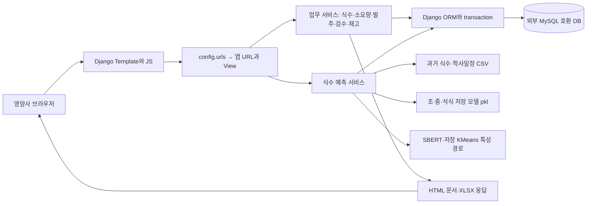
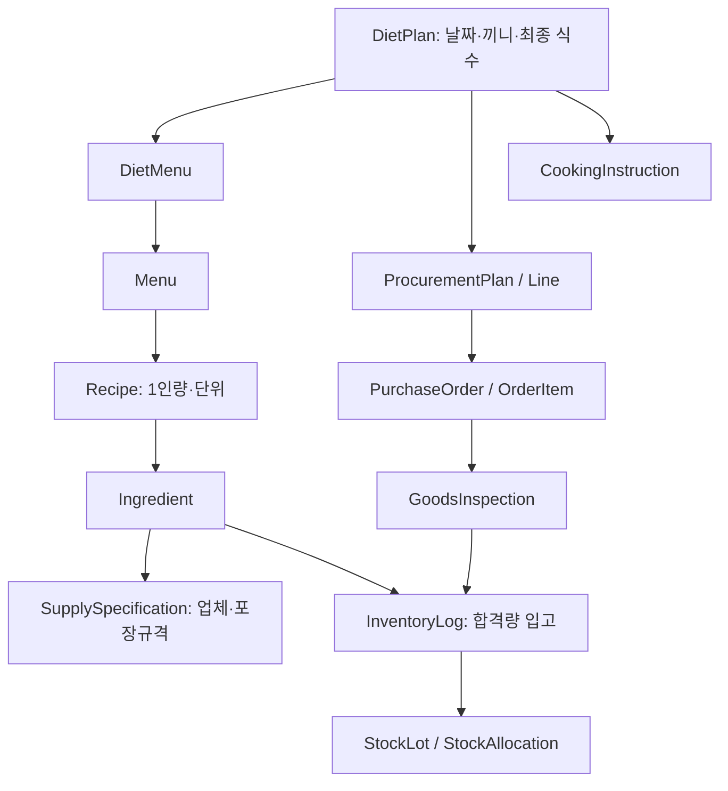

# 식수센스(SNP) — 실제 코드 기준 시스템 아키텍처

조사일 2026-10-19. 정적 소스·설정·기존 검증 산출물 조사다. 서버 실행, 컨테이너 상태 조회, DB 접속, 모델 추론은 이번에 수행하지 않았다. 아래 배포 연결은 **파일에 정의된 구조**이며 현재 가동 상태를 뜻하지 않는다.

## 기술 스택

| 계층 | 확인 기술·버전 | 실제 역할·소스 | 확인 한계 |
|---|---|---|---|
| 프론트엔드 | Django Templates, HTML/CSS, Vanilla JavaScript, Bootstrap5.3.3 CDN | `templates/base.html`, `templates/meals/`, `templates/workflow/`, `static/js/smart_order.js`, `static/css/` | React/Vue SPA 구조 아님. Bootstrap CDN 호출은 외부 네트워크에 의존하지만 기존 브라우저 검증은 외부 요청 차단 상태로 로컬 화면 확인 |
| 백엔드 | Python3.12 Docker 기반, Django6.0.3 핀 | `Dockerfile`, `requirements.txt`, `config/urls.py`; accounts/meals/inventory/forecasting/procurement 앱 | 현재 Conda3.11 환경이 서비스 환경과 동일하다는 뜻 아님. Django6은3.11과 호환되지 않음 |
| DB/접근 | Django ORM, MySQL backend, mysqlclient2.2.8 | `config/settings.py`, 앱 models/migrations, 환경변수 DB 연결 | 외부 DB 실제 엔진/버전·적용 schema는 이번에 조회 안 함. 기존 격리 검증은 MariaDB10.6과 SQLite |
| AI 데이터 처리 | pandas3.0.1, numpy2.4.3, scipy1.17.1, holidays0.93 | `forecasting/services/processor.py`, `data_loader.py` | 핀/코드 경로 확인. 모든 입력 시점의 데이터 품질·누수 검증은 별도 |
| AI 추론 | scikit-learn1.7.2, joblib1.5.3, xgboost3.2.0 등 | 저장 pkl 로드 후 model.predict | 라이브러리 설치 여부와 실제 모델의 모든 구성은 다름. 실제 로그의 상위 모델 타입은 조/중식 VotingRegressor, 석식 StackingRegressor |
| 메뉴 텍스트 특성 | sentence-transformers5.3.0, transformers5.4.0, torch2.11.0 핀 | 한국어 SBERT `snunlp/KR-SBERT-V40K-klueNLI-augSTS`, 저장 KMeans·임베딩 평균 | 기존 오프라인 시험에서는 SBERT 가중치가 없어 cluster/emb 특성이0인 fallback. 정상 임베딩 경로 통과로 발표 불가 |
| 파일/문서 | openpyxl3.1.5, xlrd2.0.2, CSV 처리 | Excel 입출력, 실제 양식 기반 XLSX, HTML window.print | 브라우저가 PDF 생성한 증거는 있으나 별도 서버 PDF 엔진/API는 없음. xlwt는 격리 테스트용 XLS fixture 생성에 사용 |
| 인증 | Django auth/session/CSRF, 커스텀 User.role | `accounts/models.py`, `accounts/views.py`, `config/business_access.py` | 역할3종(ADMIN/NUTRITIONIST/SUPPLIER). 일부 메뉴 API csrf_exempt, 공개가입 및 staff 예외가 있어 보안 전체 완료 주장 불가 |
| 배포 파일 | Dockerfile, docker-compose.yml | 이미지 capstone-web:sprint7, 내부8000, 설정상 호스트8007 | 실제 운영 reverse proxy/TLS/가용성은 확인 불가. compose 명령 실행 안 함 |

## 런타임 구조

이것은 Django 앱 안에서 직접 업무 로직과 추론을 호출하는 구조다. 별도 AI HTTP 마이크로서비스, Celery/Redis 비동기 작업 큐 또는 공급업체 전자발주 서버는 현재 경로에서 확인되지 않는다.

## 모듈 및 데이터 관계

| 앱/모델 | 주요 책임·관계 |
|---|---|
| accounts.User | AbstractUser 확장. 로그인 계정과 공급업체를 동일 User 테이블의 role로 구분 |
| meals.DietPlan / DietMenu / Menu / Recipe | 날짜·끼니별 식단→메뉴 연결→메뉴별 재료·1인량·단위. DietPlan은 수동 headcount, final_headcount, 확정시점 및 is_served 보유 |
| forecasting.AttendancePrediction | 날짜·식사·예측값·모델명·입력 특성 JSON 보존. 별도 기존 MealForecast는 DietPlan과1:1 연결되어 남아 있음 |
| inventory.Ingredient / IngredientCategory | 기준 단위·업체·안전재고·분류 등. 명칭이 같은 품목을 무조건 하나로 볼 수 있는 전역 유일 제약은 없음 |
| inventory.SupplySpecification | 품목/업체 조합별 포장1단위 내용량·기준 단위·발주 단위·증분·단가 |
| inventory.InventoryLog | 입고/출고/폐기/조정 및 거래시점·기한. 현재고는 원장 합산으로 산출 |
| StockLot / StockAllocation | 신규 입고 lot와 출고 배정 관계. 오래된 원장에 lot 이력은 자동 소급하지 않음 |
| ProcurementPlan / Line | 요청 UUID, 식단 ID/상세 스냅샷·fingerprint·재검토 상태, 발주일/재료별 필요량·재고·포장수 |
| PurchaseOrder / OrderItem | 계획과 연결된 업체별 주문 및 단가·규격·기준량/포장수 스냅샷 |
| GoodsInspection | OrderItem당1개 검수. 납품·합격량과 실제 입고 로그1:1 연결. 여러 번의 분할 검수 모델이 아님 |
| InventoryTransactionKey | 요청 UUID와 원장 연결로 같은 수동 거래의 반복 처리 제한 |
| CookingInstruction | DietPlan당1개, 공통 지시/재고 지시/레시피 ID별 비고 JSON·revision. **미커밋0005/0006 migration**과 함께 현 작업 트리에 존재 |

화살표는 업무 데이터의 주요 연결을 설명하며 모두 동일한 종류의 FK라는 뜻은 아니다(계획의 meal_ids/details는 JSON).

## AI 추론의 실제 단계

1. 예측 View가 날짜를 받고 조·중·석식의 `run_attendance_prediction()`을 호출한다.
2. model_loader가 `ml_models/best_model_breakfast.pkl`, lunch, dinner를 joblib으로 읽는다. 이전 sklearn pickle의 `_loss` 별칭 호환 코드가 있다.
3. DataProcessor가 `data/new_data.csv`와 학사일정을 읽고 대상일 행, 휴일/주말·일정·시계열 lag/EWM·메뉴 특성을 만든다. 예측 시 저장 KMeans를 주입하고 재학습 대신 transform 경로를 사용한다.
4. feature_columns가 저장돼 있으면 컬럼 순서/누락을 맞추고 model.predict를 호출, 반올림·0미만 방지 후 AttendancePrediction에 저장한다. 일부 기존 artifact에는 feature_columns 메타데이터가 없어 모든 모델에 완전 동일한 정렬 보장을 주장하지 않는다.
5. 영양사 업무 화면에서 예측은 참고값으로 표시하고 최종 식수는 별도로 확정한다. AI 실패 시 수동 업무 가능.

코드상 PCA·OOF·최신 오차 보정·자동 재학습이 모두 통합된 서비스라고 단정할 수 없다. 문서에 연구 구상이 있고 DB에 test_mae 메타데이터를 보관해도 독립 성능 평가 근거는 아니다.

## API·외부 연동 구분

- **내부 API**: Django URL의 메뉴 검색/추가/삭제, 재료 검색, 레시피 조회·Excel 업로드 등을 JS fetch로 호출한다. URL은 `meals/urls.py`, View는 `meals/views.py`와 `recipe_file_views.py`다. 별도의 Django REST Framework/OpenAPI 구조는 확인되지 않는다.
- **AI 자원**: Hugging Face 모델명으로 SBERT 로딩을 시도할 수 있다. 외부 유료 예측 API를 매번 호출하는 구조와 다르다.
- **날씨·학사일정**: CSV 로더와 파일 기반 코드가 확인된다. 현재 서비스의 실시간 기상/학사정보 API 자동 수집은 확인 불가. `data_loader.py:load_weather_data`의 존재만으로 실시간 날씨가 실제 모델 입력에 쓰인다고 주장하지 않는다.
- **scraper.py**: 이름과 달리 기존 Excel을 읽어 식재료 DB에 넣는 스크립트이며 삭제 코드도 있다. 외부 크롤링/API 성과나 안전한 운영 UI로 분류하지 않는다. 이번에 실행하지 않았다.
- **업체 주문 전송**: 생성/조회/출력은 내부 기능이다. 이메일/SMS/ERP/전자발주 전송 연동은 확인되지 않는다.

## 배포·테스트 구분

`docker-compose.yml`은 `my-capstone-sprint7`, `8007:8000`, 환경변수 DB_HOST=nextcloud-db, 외부 네트워크3개를 선언한다. 네트워크 이름만으로 실제 reverse proxy/Cloudflare/TLS 구성을 확정할 수 없다. 설정 주석의 Cloudflare/ngrok 언급과 CSRF origin 목록 역시 현재 운영 증거가 아니다.

Docker CMD는 Django **runserver**다. Gunicorn/Nginx 운영 구성이 구현됐다고 발표하지 않는다. `DEBUG=True`, wildcard ALLOWED_HOSTS 및 개발용 설정이 남아 있어 ‘운영 보안까지 완성’이라는 표현을 피한다. 비밀값·.env는 본 문서에 복사하지 않는다.

검증 설정은 별도 `config/test_settings.py`의 /tmp SQLite와 `config/test_mysql_settings.py`의 전용 MariaDB Unix socket이다. `scripts/verify_integration.sh`는 소스를 읽기 전용으로 마운트하고 네트워크를 차단한 임시 앱에서 점검한다. 이 격리 시험 성공을 기존 서비스에 migration이 이미 적용됐다는 의미로 사용하지 않는다.
